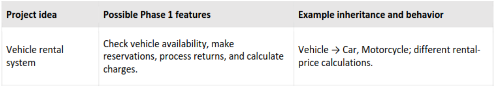
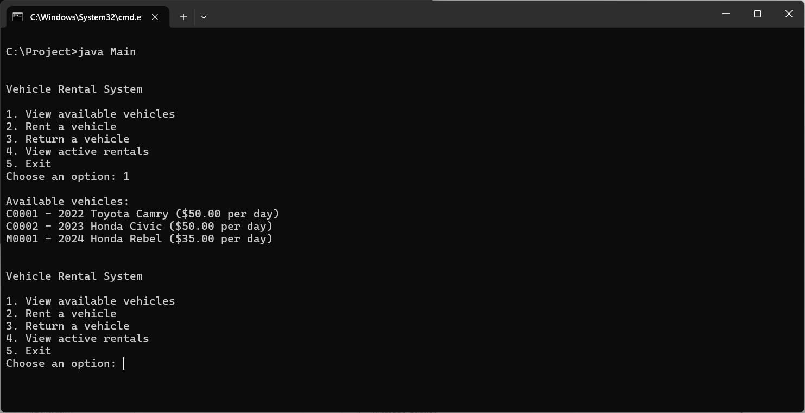

# Group: UnhandledException
Group project for CS 3354.R04 at Texas State University

<div align="center"></div>

## Purpose
The purpose of this application is to simulate the software systems commonly used by vehicle rental agencies. The application enables users to review an agency's current and projected vehicle inventory to determine which vehicles are available or expected to become available. This information allows customers to make reservations for future vehicle pickup dates based on inventory availability.

## Java version

Programmed with java version "26.0.2.1" 2026-08-18.
and java version "27" 2026-09-15

## Software Operation Instructions

To run this application, ensure that Java 26 or later is installed on your system. You can verify your installed Java version by opening a command prompt, terminal, or shell and entering the following command:

`java -version`


A valid installation should produce output similar to the following:

```
java version "27" 2026-09-15
Java(TM) SE Runtime Environment (build 27+35-2325)
Java HotSpot(TM) 64-Bit Server VM (build 27+35-2325, mixed mode, sharing)
```


Once Java has been verified, navigate to the root directory of the application. This directory should contain the file "Main.java".

The Main.java file serves as the primary application driver and entry point for the program. To launch the application, execute the following command from the root directory:

`java Main`

After the application starts, follow the on-screen prompts and instructions to interact with the software.

# Demonstration


## Features and Limitations
+ Calculates final price of rental.
+ Demonstration only. No changes are saved when exiting software; 

### Team Members
+ Jaime Martinez    -- ai declaration: TBD
+ Brandon Crenshaw  -- ai declaration: Used only to formalize the language use in this readme file.